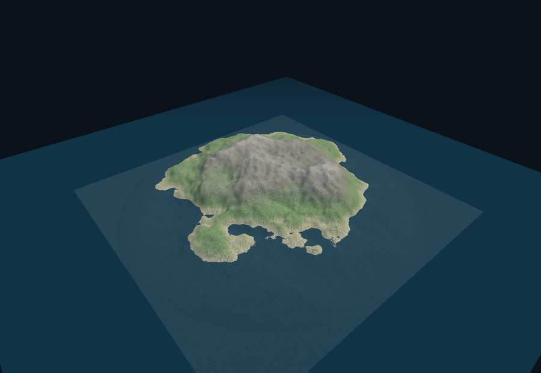
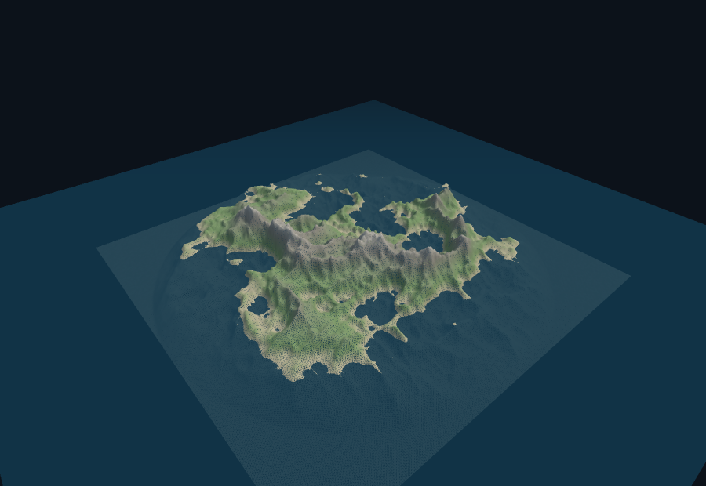
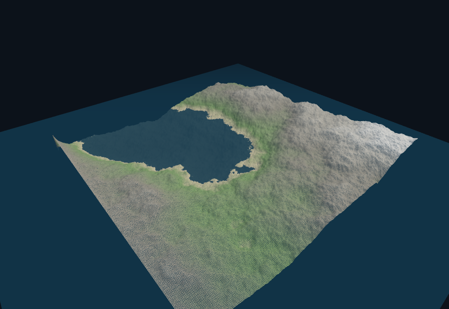

# fractal-terrain

A procedural terrain generator in the browser, which is the successor to the hand-rolled "subdivide a grid and add noise" experiments, 
aimed at the lineage of **Terragen**, **Bryce**, and **VistaPro** (see "History" below). three.js, no build step, deploys to any static host
(Cloudflare Pages, GitHub Pages, `python3 -m http.server`).

## Demo

Same seed, three algorithms:

| fractal (fBm) | ridged | diamond-square |
|---|---|---|
|  |  |  |

## Try it live

**<https://fractal-terrain.pages.dev>**

## Run it

```
python3 -m http.server 8732
```

Then open **http://localhost:8732/** . Any static server works.

Shareable links carry the scene state in the URL, e.g.
`?algo=ridged&seed=42&land=0` — `ui=0` hides the overlays for embeds.

## Deploy

No build step needed. On Cloudflare Pages: Workers & Pages → Create →
Pages → Connect to Git → pick this repo → **no build command, output
directory `/`** → deploy. Works with a private repo; the site is still
public. Direct upload also works:
`npx wrangler@3 pages deploy . --project-name fractal-terrain`
(wrangler 4 creates a Worker instead of a Pages project).

## Generators (algorithm dropdown)

- **fractal (fBm)** — value noise summed over octaves with halving
  amplitude and doubling frequency, plus a radial island falloff so the
  terrain rises out of the sea. This is the classic Terragen-style fractal
  landscape.
- **ridged** — the same octaves folded into `1-|n|²` sharp crests
  (Musgrave-style ridged multifractal). Makes mountain spines instead of
  rolling hills.
- **diamond-square** — midpoint displacement on a 2⁸+1 = 257×257 grid:
  recursively set each midpoint to the average of its neighbors plus a
  shrinking random offset. This is the recursive-subdivision algorithm.

## Controls

- **seed / ↻** — reproducible terrains; ↻ rolls a random one.
- **height** — vertical exaggeration.
- **detail** — fBm octave count (ignored by diamond-square).
- **sea** — water plane level.
- **land** — island mask strength: 100 gives an island, 0 gives open
  mountain terrain (no effect on diamond-square).
- **grid** — wireframe overlay, on by default.
- **colors** — height-band vertex colors: sand → grass → rock → snow.
- **drag** orbits, **scroll/pinch** zooms.

## Structure

| File | Role |
|---|---|
| `index.html` | page shell + parameter panel |
| `app.js` | noise generators, heightfield build, colormap, scene, custom orbit controls |
| `styles.css` | frosted control panel, mobile-first layout |
| `vendor/three/` | vendored three.js 0.170.0 module (no CDN) |

## Roadmap

- Raw 16-bit heightmap export (importable into Terragen & friends)
- Proper colormap editor (custom band stops)
- Thermal + hydraulic erosion passes
- glTF export of the mesh

## History notes (the old programs)

- **Terragen** (Planetside, 1999–) — fractal terrain + photoreal sky/water;
  the reference point for "procedural landscape as art". Heightfield import,
  fractal noise, atmosphere.
- **Bryce** (1994, MetaCreations) — fractal terrain editor + primitives;
  famous for its weird UI and cheap "landscape in a box" renders.
- **VistaPro** (1989/1993) — fractal fly-through landscapes from USGS DEMs;
  granddaddy of the genre.
- **World Machine** (2005–) — node-graph terrain; added the erosion
  simulation that made heightfields look geologically real.
- **Mojoworld** (2001–) — Pandromeda's planet-scale procedural worlds.
