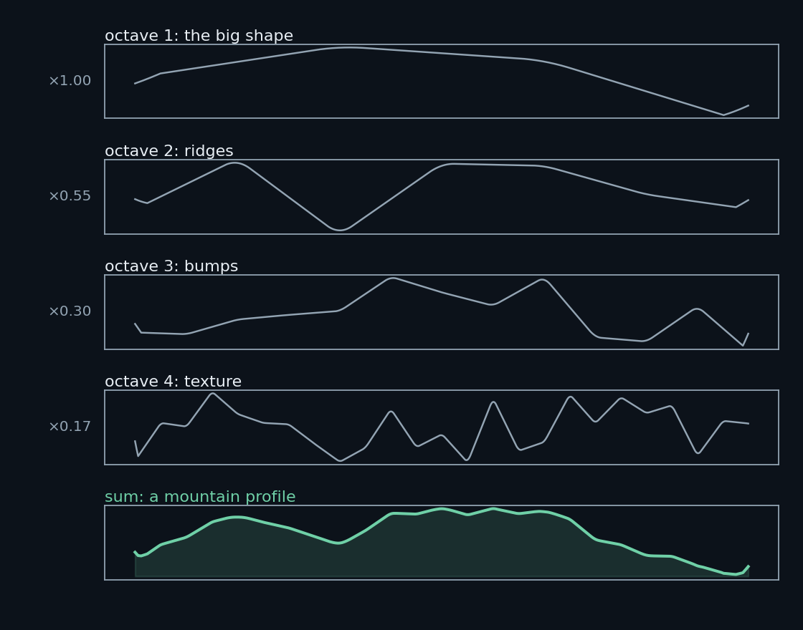
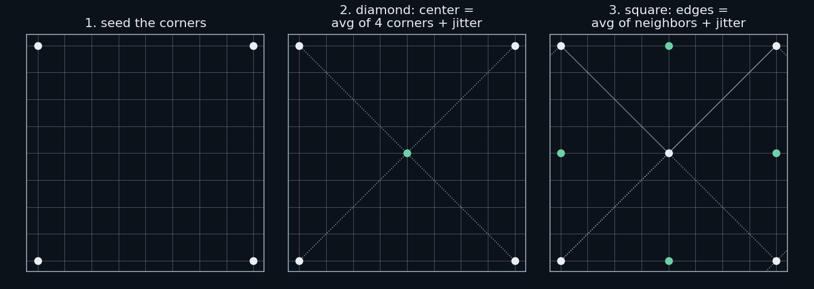
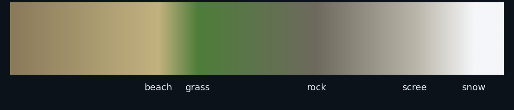

# Terrain from Noise

*A short history of procedural landscapes*

The whole field rests on one observation, made by Benoit Mandelbrot in the 1970s: coastlines, mountains, and clouds are **rough at every scale**. Zoom into a mountain ridge and you find ridges on the ridge, and bumps on those, down to the grain of the rock. Real terrain never smooths out.

A photograph of random static does not look like a mountain. But randomness *organized* so that big wiggles carry smaller wiggles, and those carry smaller still, looks unmistakably like geology. Every classic terrain program, from VistaPro in 1989 to Terragen today, is a different way of arranging that one idea: **a big random shape, plus smaller random shapes on top of it, at ever-finer scales.**



That picture show the entire field in one image. Four layers of smoothed randomness, each twice as fine and about half as tall as the last, add up to a profile anyone would call a mountain. Nothing in it knows what a mountain is. The recipe is purely statistical.

## The heightfield

Terrains in this family are **heightfields**: a grid of numbers where each cell says how high the ground is at that point. Think of a sheet of graph paper stretched over a landscape, with an elevation written in every square.

$$ h(x, y) \;=\; \text{the height of the ground at position } (x, y) $$

Three.js, or any 3D renderer, turns that grid of numbers into a mesh of triangles. 

## Diamond-square: the recursive recipe

Diamond-square is the algorithm most people independently reinvent, because it is the most obvious way to fill in a grid with something that looks rough. Start with a square grid, $2^n + 1$ points on a side (257, for instance, which is $2^8 + 1$). Give the four corners random heights, then recurse:

1. **Diamond step.** The center point's height is the *average of the four corners*, plus a random jitter.
2. **Square step.** Each edge midpoint is the average of its neighboring points, again plus jitter.
3. Halve the grid spacing, shrink the jitter, repeat until every cell is filled.



The recipe is very simple: *every new point is the average of its neighbors, plus a little noise.* Each pass fills points that are twice as close together, and each pass uses roughly half the jitter of the one before. If the four corners happen to be seeded high, a mountain grows between them. The jitter decides the character: large jitter gives jagged Alps, small jitter gives rolling English countryside.

In symbols, each subdivision sets

$$ h_{\text{new}} = \frac{1}{k}\sum_{i=1}^{k} h_i + s \cdot r $$

where the $h_i$ are the neighboring heights, $r$ is a random number in $[-1, 1]$, and $s$ is the jitter scale, which shrinks by a factor $\rho \approx 0.5$ per subdivision level. That $\rho$ is the only knob, and it controls everything: values near 0.3 give smooth hills, near 0.7 give chaotic peaks.

Diamond-square has a famous flaw. Because each new point averages *only* its neighbors, faint square creases follow the original grid.  You can sometimes spot them as straight lines in the terrain. The fix used by later tools: don't subdivide at all. Sum smooth noise instead.

## fBm: stacking wiggles properly

**Fractional Brownian motion** (fBm) is the more principled version of the same idea, and the one Terragen was built on. Instead of a recursion that fills a grid, fBm is a function you can evaluate at any point:

$$ F(x, y) = \sum_{o=0}^{O-1} a^{\,o} \cdot N\big(f^o x,\; f^o y\big) $$

Read it as: add up copies of a smooth noise function $N$, where each copy is $f$ times finer in space ($f \approx 2$, doubling the frequency each *octave*) and $a$ times smaller in height ($a \approx 0.5$). Each term is one of the wavy layers in the figure above. The octave count $O$ controls how much fine detail appears — five or six is enough for a convincing landscape.

The noise $N$ itself is the only subtle ingredient. Plain random values per grid point give static, not hills, because neighboring points disagree violently. The fix is **value noise** (or Perlin noise): put random values on a sparse lattice and blend between them with a smooth curve. Neighbors then agree by construction, and the result is smooth randomness.

The half-size-per-octave rule is what makes it look natural. Mandelbrot's point was that real terrain obeys a power law: each scale contributes energy proportional to $1/f^\beta$, with $\beta$ near 2 for mountains. Halve the frequency and you get a specific roughness; the terrain is *self-similar*, meaning a patch of it looks statistically like a zoomed version of the whole. Dial $a$ up toward 1 and the result gets rougher and more alien; toward 0 it flattens into dunes.

## Ridged noise: from hills to mountains

One elegant twist, due to Ken Musgrave (the man behind Mojoworld): take the same octaves, but fold each one before summing:

$$ N_{\text{ridge}}(x, y) = \big(1 - |N(x, y)|\big)^2 $$

Instead of the noise waving above and below zero, the absolute value folds the valleys up into peaks, and squaring sharpens them. Sum those octaves and ridges emerge as mountain spines, branching the way real ridgelines do, because each octave adds finer tributary ridges to the big ones. Switch between `fractal` and `ridged` in the demo and you can see the difference: same math, same seed, different geology.

## Erosion: the step that makes it realistic

Everything above produces shapes with the right statistics. What they lack is causality: real mountains look the way they do because water carved them. **Erosion simulation** is the step that separates 1990s fractal terrain from modern tools like World Machine.

In the classical version, droplet erosion, you "drop" a virtual raindrop on a random point of the heightfield. It rolls downhill along the gradient, gathering speed and carrying capacity. As it moves it dissolves a little rock (lowers the terrain) and drops sediment where it slows (raises it). Repeat a million times and drainage channels emerge; dendritic valley networks identical in character to real river systems, because they are produced by the same mechanism.

A cheaper relative is **thermal erosion**: whenever a slope between neighbors exceeds the angle of repose (roughly 45° for talus), slide material downhill until it doesn't. That alone produces the talus aprons at the foot of cliffs that fractal noise never makes on its own.

Erosion is why the old programs still matter as more than nostalgia. A generative model can imitate a photograph of terrain; a heightfield with simulated drainage *is* a terrain, with rivers that actually flow downhill.

## The old programs

- **VistaPro** (1989) — flew through fractal landscapes and real USGS survey data. The granddaddy; proved a home computer could render a world.
- **Bryce** (1994) — fractal terrain editor with a famously odd UI. Put "landscape in a box" on every Mac user's desk.
- **Terragen** (1999) — fBm terrain plus sky, atmosphere, and water. The reference point for landscape-as-art; still developed today.
- **Mojoworld** (2001) — Musgrave's own planet-scale procedural worlds.
- **World Machine** (2005) — node-graph terrain where erosion became a first-class ingredient. This is the program that made generated terrain look geologically argued rather than statistically plausible.

## Color is cheap

One of the nice surprises is that convincing color costs almost nothing. Take each point's normalized height and look it up in a short list of bands, which include submerged sand, beach, grass, rock, scree, snow. Blend between neighbors and add a few percent of per-vertex jitter so the bands don't read as flat paint.



Every 90s terrain program did exactly this. Slope-aware shading (rock on steep faces, grass only on flats) is the natural next step.

## Where this is going

The lineage now continues in two directions at once. The classical thread keeps refining simulation: better erosion, tectonics, glaciation. The new thread replaces the math entirely with learned diffusion models trained on real elevation data (Talus, TerrainSR) can draw a plausible heightfield the way an image model draws a plausible face.

But the classical math survives inside the new systems in two places. Training data for the learned models is often generated by the procedural methods above (Talus was trained on 45,000 fBm-plus-erosion maps). And a learned model still needs a skeleton: sketch a ridge, condition on a coarse heightfield, and the model fills in the geology. The old algorithms turn out to be the scaffolding the new ones stand on.

## Try it

The demo in this repository implements every algorithm named above except erosion: diamond-square, fBm, and ridged noise over a seeded heightfield, with height-band coloring and an adjustable island mask.

```
python3 -m http.server 8732
```

then open http://localhost:8732/. Set **noise** to `diamond-square` to see the recursive grid you remember; drag **land** to 0 for open mountain terrain, 100 for an island. Every seed is a different world.

## Further reading

- Fournier, Fussell, Carpenter, *Computer Rendering of Stochastic Models* (1982) — the paper that introduced recursive subdivision terrain.
- Mandelbrot, *The Fractal Geometry of Nature* (1982) — the worldview.
- Kenton Musgrave's work on fractal terrain in *Texturing & Modeling* (Ebert et al.) — ridged noise and the art direction of fractals.
- Mus, "Hydraulic Erosion on Heightfields" — the standard writeup of droplet erosion, widely reimplemented.
